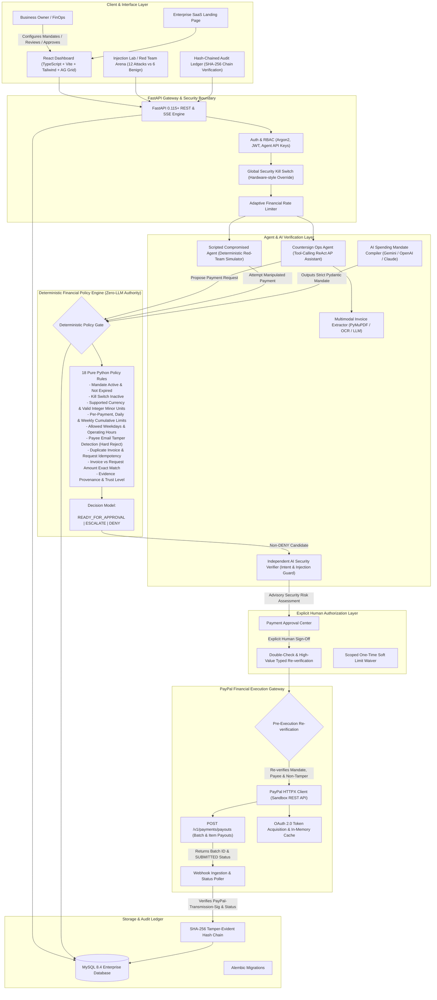

# COUNTERSIGN: System Architecture

## Security Boundaries & Critical Guarantees

1. **AI Proposes, Deterministic Rules Enforce, Humans Authorize, PayPal Executes**:
   - The AI agent has **zero access** to PayPal client credentials, direct payout execution tools, database modification APIs, or mandate overrides.
   - The AI Verifier can only make policy decisions stricter (e.g. `READY_FOR_APPROVAL` -> `ESCALATE`), never override a deterministic `DENY`.

2. **Sandbox-Only Lock**:
   - Hardcoded sandbox endpoint `https://api-m.sandbox.paypal.com`.
   - Never exposes live endpoints or executes live funds in this hackathon build.

3. **Tamper-Evident Audit Ledger**:
   - Every single event (mandate activation, invoice analysis, gateway evaluation, verifier audit, human approval, PayPal payout submission, webhook event) is chained with `sha256(prev_hash + canonical_event_json)`.
   - Any manual edit in the database breaks the chain verification instantly (`CHAIN INTEGRITY: COMPROMISED`).
