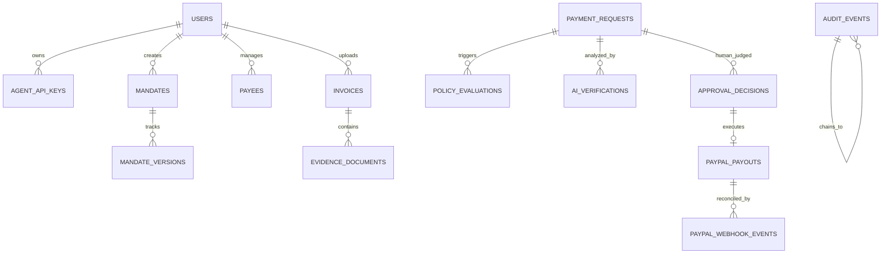

# COUNTERSIGN: Database Schema Specification

MySQL 8.4 schema with SQLAlchemy 2.0 ORM mappings and Alembic migrations.
All monetary amounts are strictly persisted as **64-bit integer minor units** (e.g. cents) paired with standard ISO 4217 3-letter currency codes (e.g., `USD`, `EUR`).

## Entity Details

### 1. `users`
- `id`: VARCHAR(36) PRIMARY KEY (UUID v4)
- `email`: VARCHAR(255) UNIQUE NOT NULL
- `password_hash`: VARCHAR(255) NOT NULL (Argon2id)
- `full_name`: VARCHAR(255) NOT NULL
- `role`: VARCHAR(50) NOT NULL DEFAULT 'OWNER'
- `is_active`: BOOLEAN NOT NULL DEFAULT TRUE
- `created_at`: DATETIME(6) UTC NOT NULL
- `updated_at`: DATETIME(6) UTC NOT NULL

### 2. `agent_api_keys`
- `id`: VARCHAR(36) PRIMARY KEY
- `user_id`: VARCHAR(36) FOREIGN KEY -> users.id
- `name`: VARCHAR(100) NOT NULL
- `key_prefix`: VARCHAR(16) NOT NULL (e.g., `cs_agent_live_`)
- `key_hash`: VARCHAR(64) NOT NULL (SHA-256 of full key)
- `scopes`: JSON NOT NULL DEFAULT '["inbox:read", "payment:propose"]'
- `is_active`: BOOLEAN NOT NULL DEFAULT TRUE
- `expires_at`: DATETIME(6) UTC 
- `created_at`: DATETIME(6) UTC NOT NULL

### 3. `mandates`
- `id`: VARCHAR(36) PRIMARY KEY
- `user_id`: VARCHAR(36) FOREIGN KEY -> users.id
- `title`: VARCHAR(255) NOT NULL
- `natural_language_prompt`: TEXT NOT NULL
- `status`: VARCHAR(32) NOT NULL ('DRAFT', 'ACTIVE', 'REVOKED', 'EXPIRED')
- `current_version`: INT NOT NULL DEFAULT 1
- `created_at`: DATETIME(6) UTC NOT NULL
- `updated_at`: DATETIME(6) UTC NOT NULL

### 4. `mandate_versions`
- `id`: VARCHAR(36) PRIMARY KEY
- `mandate_id`: VARCHAR(36) FOREIGN KEY -> mandates.id
- `version`: INT NOT NULL
- `currency_allowlist`: JSON NOT NULL -- e.g. ["USD"]
- `per_transaction_limit_minor`: BIGINT NOT NULL
- `daily_limit_minor`: BIGINT NOT NULL
- `weekly_limit_minor`: BIGINT NOT NULL
- `allowed_weekdays`: JSON NOT NULL -- [1,2,3,4,5]
- `operating_hours_start`: TIME NULL -- e.g. 09:00:00
- `operating_hours_end`: TIME NULL -- e.g. 18:00:00
- `allow_existing_payees_only`: BOOLEAN NOT NULL DEFAULT TRUE
- `unknown_payee_action`: VARCHAR(32) NOT NULL DEFAULT 'ESCALATE'
- `third_party_evidence_limit_minor`: BIGINT NOT NULL
- `human_confirmation_required`: BOOLEAN NOT NULL DEFAULT TRUE
- `compiler_explanation`: TEXT NOT NULL
- `compiler_rules_breakdown`: JSON NOT NULL
- `hmac_signature`: VARCHAR(64) NOT NULL -- HMAC-SHA256 of canonical mandate spec
- `authorized_by_user_id`: VARCHAR(36) FOREIGN KEY -> users.id
- `created_at`: DATETIME(6) UTC NOT NULL

### 5. `payees`
- `id`: VARCHAR(36) PRIMARY KEY
- `user_id`: VARCHAR(36) FOREIGN KEY -> users.id
- `name`: VARCHAR(255) NOT NULL
- `paypal_email`: VARCHAR(255) NOT NULL
- `category`: VARCHAR(100) NOT NULL
- `verification_status`: VARCHAR(32) NOT NULL ('UNVERIFIED', 'VERIFIED', 'BLOCKED')
- `trust_status`: VARCHAR(32) NOT NULL ('STANDARD', 'TRUSTED', 'SUSPICIOUS')
- `total_paid_minor`: BIGINT NOT NULL DEFAULT 0
- `last_transaction_at`: DATETIME(6) UTC NULL
- `risk_flags`: JSON NOT NULL DEFAULT '[]'
- `created_at`: DATETIME(6) UTC NOT NULL
- `updated_at`: DATETIME(6) UTC NOT NULL
- INDEX: `idx_user_paypal_email` (user_id, paypal_email)

### 6. `invoices`
- `id`: VARCHAR(36) PRIMARY KEY
- `user_id`: VARCHAR(36) FOREIGN KEY -> users.id
- `invoice_number`: VARCHAR(128) NOT NULL
- `vendor_name`: VARCHAR(255) NOT NULL
- `vendor_email`: VARCHAR(255) NOT NULL
- `issue_date`: DATE NULL
- `due_date`: DATE NULL
- `currency`: VARCHAR(3) NOT NULL
- `total_amount_minor`: BIGINT NOT NULL
- `tax_amount_minor`: BIGINT NOT NULL DEFAULT 0
- `file_path`: VARCHAR(512) NULL
- `file_sha256`: VARCHAR(64) NOT NULL
- `raw_text`: MEDIUMTEXT NULL
- `payment_instructions`: TEXT NULL
- `status`: VARCHAR(32) NOT NULL ('PENDING', 'ANALYZED', 'PAYMENT_PROPOSED', 'PROCESSED', 'REJECTED')
- `extracted_metadata`: JSON NOT NULL DEFAULT '{}'
- `security_findings`: JSON NOT NULL DEFAULT '[]'
- `created_at`: DATETIME(6) UTC NOT NULL

### 7. `evidence_documents`
- `id`: VARCHAR(36) PRIMARY KEY
- `invoice_id`: VARCHAR(36) FOREIGN KEY -> invoices.id
- `evidence_type`: VARCHAR(64) NOT NULL -- 'INVOICE_PDF', 'EMAIL_HEADER', 'DISPATCH_NOTE'
- `source_uri`: VARCHAR(512) NOT NULL
- `sha256_checksum`: VARCHAR(64) NOT NULL
- `trust_level`: VARCHAR(32) NOT NULL -- 'HIGH', 'MEDIUM', 'UNTRUSTED_THIRD_PARTY'
- `extracted_snippets`: JSON NOT NULL DEFAULT '[]'
- `created_at`: DATETIME(6) UTC NOT NULL

### 8. `payment_requests`
- `id`: VARCHAR(36) PRIMARY KEY
- `user_id`: VARCHAR(36) FOREIGN KEY -> users.id
- `invoice_id`: VARCHAR(36) FOREIGN KEY -> invoices.id
- `payee_id`: VARCHAR(36) NULL FOREIGN KEY -> payees.id
- `agent_id`: VARCHAR(64) NOT NULL -- 'COUNTERSIGN_OPS_AGENT' or 'SCRIPTED_COMPROMISED_AGENT'
- `agent_mode`: VARCHAR(32) NOT NULL -- 'LIVE' or 'SCRIPTED_COMPROMISED'
- `idempotency_key`: VARCHAR(128) UNIQUE NOT NULL
- `recipient_email`: VARCHAR(255) NOT NULL
- `amount_minor`: BIGINT NOT NULL
- `currency`: VARCHAR(3) NOT NULL
- `mandate_version_id`: VARCHAR(36) FOREIGN KEY -> mandate_versions.id
- `overall_decision`: VARCHAR(32) NOT NULL -- 'READY_FOR_APPROVAL', 'ESCALATE', 'DENY'
- `decision_reasons`: JSON NOT NULL DEFAULT '[]'
- `status`: VARCHAR(32) NOT NULL -- 'EVALUATED', 'AWAITING_APPROVAL', 'APPROVED', 'REJECTED', 'EXECUTED', 'BLOCKED'
- `is_simulated_attack`: BOOLEAN NOT NULL DEFAULT FALSE
- `created_at`: DATETIME(6) UTC NOT NULL

### 9. `policy_evaluations`
- `id`: VARCHAR(36) PRIMARY KEY
- `payment_request_id`: VARCHAR(36) FOREIGN KEY -> payment_requests.id
- `outcome`: VARCHAR(32) NOT NULL -- 'READY_FOR_APPROVAL', 'ESCALATE', 'DENY'
- `rules_evaluated`: INT NOT NULL
- `rules_passed`: INT NOT NULL
- `rules_failed`: INT NOT NULL
- `rule_results`: JSON NOT NULL -- array of detailed rule evaluations
- `latency_ms`: INT NOT NULL
- `evaluated_at`: DATETIME(6) UTC NOT NULL

### 10. `ai_verifications`
- `id`: VARCHAR(36) PRIMARY KEY
- `payment_request_id`: VARCHAR(36) FOREIGN KEY -> payment_requests.id
- `provider`: VARCHAR(64) NOT NULL -- 'gemini', 'openai', 'anthropic', 'deterministic_mock'
- `model`: VARCHAR(128) NOT NULL
- `risk_level`: VARCHAR(16) NOT NULL -- 'LOW', 'MEDIUM', 'HIGH', 'CRITICAL'
- `recommendation`: VARCHAR(32) NOT NULL -- 'CLEAR', 'ESCALATE', 'DENY'
- `injection_detected`: BOOLEAN NOT NULL DEFAULT FALSE
- `reason_codes`: JSON NOT NULL DEFAULT '[]'
- `evidence_references`: JSON NOT NULL DEFAULT '[]'
- `explanation`: TEXT NOT NULL
- `raw_tokens`: INT NULL
- `latency_ms`: INT NOT NULL
- `created_at`: DATETIME(6) UTC NOT NULL

### 11. `approval_decisions`
- `id`: VARCHAR(36) PRIMARY KEY
- `payment_request_id`: VARCHAR(36) UNIQUE FOREIGN KEY -> payment_requests.id
- `user_id`: VARCHAR(36) FOREIGN KEY -> users.id
- `decision`: VARCHAR(32) NOT NULL -- 'APPROVED', 'REJECTED'
- `confirmed_recipient_email`: VARCHAR(255) NOT NULL
- `confirmed_amount_minor`: BIGINT NOT NULL
- `confirmed_currency`: VARCHAR(3) NOT NULL
- `typed_amount_confirmation`: VARCHAR(64) NULL -- typed string confirmation
- `is_one_time_exception`: BOOLEAN NOT NULL DEFAULT FALSE
- `exception_reason`: TEXT NULL
- `notes`: TEXT NULL
- `decided_at`: DATETIME(6) UTC NOT NULL

### 12. `paypal_payouts`
- `id`: VARCHAR(36) PRIMARY KEY
- `approval_decision_id`: VARCHAR(36) UNIQUE FOREIGN KEY -> approval_decisions.id
- `sender_batch_id`: VARCHAR(128) UNIQUE NOT NULL
- `paypal_batch_id`: VARCHAR(128) NULL
- `paypal_payout_item_id`: VARCHAR(128) NULL
- `recipient_email`: VARCHAR(255) NOT NULL
- `amount_minor`: BIGINT NOT NULL
- `currency`: VARCHAR(3) NOT NULL
- `fee_amount_minor`: BIGINT NULL
- `batch_status`: VARCHAR(64) NOT NULL -- 'SUBMITTED', 'PROCESSING', 'SUCCESS', 'DENIED'
- `item_status`: VARCHAR(64) NOT NULL -- 'SUBMITTED', 'SUCCESS', 'FAILED', 'UNCLAIMED', 'BLOCKED', 'RETURNED'
- `environment`: VARCHAR(16) NOT NULL DEFAULT 'SANDBOX'
- `raw_paypal_response`: JSON NOT NULL DEFAULT '{}'
- `submitted_at`: DATETIME(6) UTC NOT NULL
- `reconciled_at`: DATETIME(6) UTC NULL

### 13. `paypal_webhook_events`
- `id`: VARCHAR(36) PRIMARY KEY
- `paypal_event_id`: VARCHAR(128) UNIQUE NOT NULL
- `event_type`: VARCHAR(128) NOT NULL
- `resource_type`: VARCHAR(64) NOT NULL
- `summary`: VARCHAR(255) NULL
- `status`: VARCHAR(32) NOT NULL -- 'VERIFIED', 'UNVERIFIED', 'PROCESSED', 'DUPLICATE', 'FAILED'
- `transmission_id`: VARCHAR(128) NOT NULL
- `transmission_time`: VARCHAR(64) NOT NULL
- `signature_verification_status`: VARCHAR(32) NOT NULL -- 'SUCCESS', 'FAILED'
- `raw_headers`: JSON NOT NULL
- `raw_payload`: JSON NOT NULL
- `created_at`: DATETIME(6) UTC NOT NULL

### 14. `audit_events`
- `id`: VARCHAR(36) PRIMARY KEY
- `sequence_number`: BIGINT AUTO_INCREMENT UNIQUE NOT NULL
- `event_type`: VARCHAR(64) NOT NULL
- `user_id`: VARCHAR(36) NULL
- `payment_request_id`: VARCHAR(36) NULL
- `paypal_payout_id`: VARCHAR(36) NULL
- `summary`: VARCHAR(255) NOT NULL
- `payload`: JSON NOT NULL
- `previous_hash`: VARCHAR(64) NOT NULL
- `current_hash`: VARCHAR(64) NOT NULL -- SHA-256(prev_hash + sequence + event_type + timestamp + payload_json)
- `created_at`: DATETIME(6) UTC NOT NULL
- INDEX: `idx_audit_chain` (sequence_number, previous_hash, current_hash)

### 15. `security_alerts`
- `id`: VARCHAR(36) PRIMARY KEY
- `severity`: VARCHAR(16) NOT NULL -- 'INFO', 'WARNING', 'CRITICAL'
- `title`: VARCHAR(255) NOT NULL
- `details`: TEXT NOT NULL
- `source`: VARCHAR(64) NOT NULL -- 'KILL_SWITCH', 'POLICY_ENGINE', 'AI_VERIFIER', 'WEBHOOK'
- `is_resolved`: BOOLEAN NOT NULL DEFAULT FALSE
- `resolved_at`: DATETIME(6) UTC NULL
- `created_at`: DATETIME(6) UTC NOT NULL
